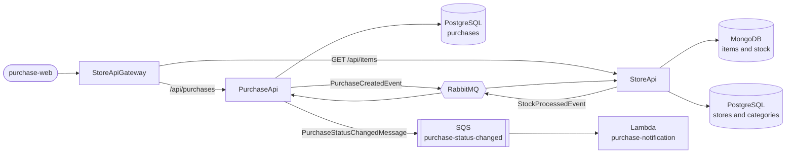

# StoreApi

ASP.NET Core store API built with DDD. It manages stores, categories and items, and takes part in the purchase flow: when the PurchaseApi announces a new purchase, the StoreApi deducts the stock and replies with the result. The item catalog is exposed to the web front end (read only) through the StoreApiGateway.

## Features

- Store registration and lookup
- Category registration and listing
- Item catalog, stored in MongoDB, with paginated listing
- Idempotent stock deduction triggered by purchase events
- Asynchronous integration with the PurchaseApi through RabbitMQ (MassTransit)

## Endpoints

| Method | Route | Description |
| --- | --- | --- |
| POST | /api/store | Registers a store |
| GET | /api/store | Lists stores |
| GET | /api/store/{storeName} | Finds a store by name |
| POST | /api/category | Registers a category |
| GET | /api/category | Lists categories |
| POST | /api/item | Registers an item |
| GET | /api/item?page=1&pageSize=10 | Lists items, paginated (at most 50 per page) |
| GET | /api/item/{id} | Finds an item by id; 404 if it does not exist |

Item list response:

```json
{
  "itens": [
    {
      "id": "6ad4def84c3f10514043a630",
      "title": "teste2",
      "description": "teste2",
      "quantity": 1,
      "price": 1,
      "categoryId": 1,
      "storeId": 1
    }
  ],
  "page": 1,
  "pageSize": 10,
  "totalItens": 3,
  "totalPages": 1
}
```

`quantity` is the current stock of the item.

Through the StoreApiGateway, only `GET /api/items` (rewritten to `/api/item`) is public. Registrations (`POST`) are done directly on the StoreApi, which keeps the write operations away from the web front end.

## Purchase flow

1. The PurchaseApi publishes a `PurchaseCreatedEvent` to RabbitMQ.
2. A consumer in the Api project receives the event and calls the `ProcessPurchaseCreatedUseCase`.
3. The use case deducts the stock of the purchased items.
4. The StoreApi publishes a `StockProcessedEvent` with the result.
5. The PurchaseApi consumes it and marks the purchase as `Confirmed` or `Rejected`.

Both APIs share the event contracts under the `Contracts.Events` namespace.

### Idempotent stock deduction

Messages can be delivered more than once, so the deduction must not be applied twice for the same purchase. The `ItemStockRepository` runs a single atomic update in MongoDB that changes the item `Quantity` and records the purchase id in the item `ProcessedPurchases` list. A purchase that was already processed is not applied again.

## Architecture



## Tech stack

- ASP.NET Core (.NET 8) with AutoMapper
- PostgreSQL: stores and categories
- MongoDB: items and stock
- RabbitMQ with MassTransit
- Docker and Docker Compose

## Solution structure

| Project | Responsibility |
| --- | --- |
| Api | Controllers, configuration and message consumers |
| Application | Use cases and mappings (AutoMapper) |
| Communication | Requests and responses |
| Domain | Entities, value rules and repository interfaces |
| Exception | Domain and application exceptions |
| Infrastructure | Data access (PostgreSQL and MongoDB) and messaging |

Design decisions:

- Aggregates reference each other by id only (an `Item` holds a `StoreId` and a `CategoryId`, with no navigation properties).
- `Category` is an entity referenced by `CategoryId`, not an enum.
- Names of stores and categories are normalized before being saved.
- Items live in MongoDB (read-heavy catalog and atomic stock updates), while stores and categories live in PostgreSQL.

## Running

Prerequisites: Docker and Docker Compose.

The StoreApi compose brings up the API, PostgreSQL, MongoDB and RabbitMQ. It shares the `shared-net` network with the PurchaseApi and StoreApiGateway composes, so the three projects reach each other by service name (the gateway calls this API at `http://storeapi:8080/`) and both APIs use the same RabbitMQ.

| Service | Port |
| --- | --- |
| StoreApi | 8080 |
| PostgreSQL | 5433 (host) -> 5432 (container) |
| MongoDB | 27017 |
| RabbitMQ | 5672 (management UI on 15672) |

The environment variables (`PG_USER`, `PG_PASSWORD`, `RABBIT_USER`, `RABBIT_PASSWORD`) live in a `.env` file next to the compose file. Docker Compose reads it to fill the `${...}` placeholders. A `.env.example` lists the variable names without values.

The API image is built from a Dockerfile based on .NET 8 Alpine.

## Known limitations

- The StoreApi does not yet validate the purchase total against `price * quantity`. The total sent by the client is accepted as it is. The fix belongs here, when the `PurchaseCreatedEvent` is processed.
- The item list is limited to 50 items per page.
- There is no authentication.

## Related projects

- PurchaseApi: creates purchases, consumes the stock result and notifies status changes.
- StoreApiGateway: single entry point for clients; exposes the purchase routes and the item list (read only).
- purchase-web: Next.js front end for creating and following purchases.