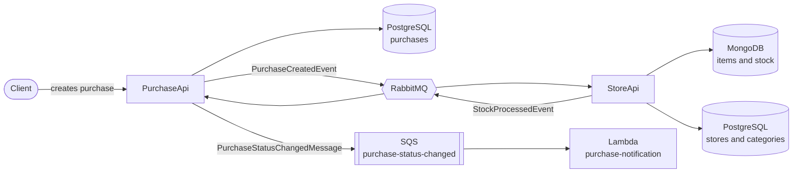

# StoreApi

ASP.NET Core store API built with DDD. It manages stores, categories and items, and takes part in the purchase flow: when the PurchaseApi announces a new purchase, the StoreApi deducts the stock and replies with the result.

## Features

- Store registration
- Category registration
- Item catalog, stored in MongoDB
- Idempotent stock deduction triggered by purchase events
- Asynchronous integration with the PurchaseApi through RabbitMQ (MassTransit)

## Purchase flow

1. The PurchaseApi publishes a `PurchaseCreatedEvent` to RabbitMQ.
2. A consumer in the Api project receives the event and calls the `ProcessPurchaseCreatedUseCase`.
3. The use case deducts the stock of the purchased items.
4. The StoreApi publishes a `StockProcessedEvent` with the result.
5. The PurchaseApi consumes it and marks the purchase as `Confirmed` or `Rejected`.

Both APIs share the event contracts under the `Contracts.Events` namespace.

### Idempotent stock deduction

Messages can be delivered more than once, so the deduction must not be applied twice for the same purchase. The `ItemStockRepository` runs a single atomic update in MongoDB that changes the item `Quantity` and records the purchase id in the item `ProcessedPurchases` list. A purchase that was already processed is not applied again.

## Architecture

## Tech stack

- ASP.NET Core (.NET 8) with AutoMapper
- PostgreSQL: stores and categories
- MongoDB: items and stock
- RabbitMQ with MassTransit
- Docker and Docker Compose

## Solution structure

| Project | Responsibility |
| --- | --- |
| Api | Controllers, configuration and message consumers |
| Application | Use cases and mappings (AutoMapper) |
| Communication | Requests and responses |
| Domain | Entities, value rules and repository interfaces |
| Exception | Domain and application exceptions |
| Infrastructure | Data access (PostgreSQL and MongoDB) and messaging |

Design decisions:

- Aggregates reference each other by id only (an `Item` holds a `StoreId` and a `CategoryId`, with no navigation properties).
- `Category` is an entity referenced by `CategoryId`, not an enum.
- `StoreId` is sent in the request and is not returned in the response.
- Names of stores and categories are normalized before being saved.

## Running

Prerequisites: Docker and Docker Compose.

The StoreApi compose brings up the API, PostgreSQL, MongoDB and RabbitMQ. It shares the `shared-net` network with the PurchaseApi compose, so both APIs reach the same RabbitMQ.

| Service | Port |
| --- | --- |
| StoreApi | 8080 |
| PostgreSQL | 5433 (host) -> 5432 (container) |
| MongoDB | 27017 |
| RabbitMQ | 5672 (management UI on 15672) |

The API image is built from a Dockerfile based on .NET 8 Alpine.

## Related projects

- PurchaseApi: creates purchases, consumes the stock result and notifies status changes.
